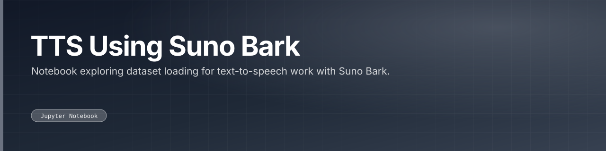

Notebook exploring dataset loading for text-to-speech work with Suno Bark.

 

 

---

## What this is

A small notebook loading datasets via Hugging Face `datasets` as groundwork for text-to-speech experiments with Suno Bark. Exploratory rather than a working pipeline.

---

<a href="https://github.com/gowtham-creator/TTS-using-Suno-bark">gowtham-creator/TTS-using-Suno-bark</a>

